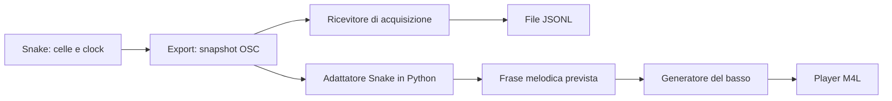

# Export Snake

Stato verificato il 12 ottobre 2026. Questa guida descrive il codice presente; il piano finale distingue le verifiche ancora aperte.

## Scopo

Export comunica a Python lo stato musicale di Snake e la posizione dei suoi sequencer. Python usa questi dati per prevedere gli attacchi futuri senza aspettare le note MIDI in uscita.

L'obiettivo d'uso è che Snake fornisca al basso stato e posizione: l'adattatore li traduce in una frase e il motore decide come accompagnarla. Le prove offline dai pattern GPX servono solo a confrontare idee musicali con un profilo Snake dichiarato; non sostituiscono né cambiano il flusso live.

Il pulsante attiva l’invio. Non registra file, non avvia Python e non genera il basso. Se nessun programma ascolta, i messaggi non vengono conservati.



Acquisizione e basso live sono due ricevitori alternativi: entrambi usano normalmente la porta 9003. Non vanno avviati insieme sulla stessa porta.

## Lettura dentro il device

Il builder aggiunge alla mod tre componenti:

1. **Lettori numerici delle celle e dello Shift.** Ricevono gli stessi aggiornamenti dei display originali. Non rimandano valori al sequencer. Le altezze sono già quantizzate da Snake: Export invia il numero MIDI effettivo e imposta `midi_offset` a zero.
2. **Lettura della posizione dei tre banchi.** Ogni avanzamento di Notes, Gates e Velocities viene associato alla posizione del trasporto, letta in tick da `when`. Gli eventi passano tramite `deferlow` al JS, che conserva l’ultima posizione osservata di ciascun banco.
3. **Campionamento periodico.** Export abilita `qmetro 125`: nominalmente ogni 125 ms legge posizione, BPM e Play/Stop dal trasporto e costruisce uno snapshot. La cadenza dipende dallo scheduler; non è un clock audio garantito.

Il MIDI continua a essere prodotto dal sequencer nativo. La frequenza degli snapshot non determina la frequenza delle note.

## Contenuto dei messaggi

Invio locale tramite UDP, porta predefinita **9003**, indirizzo OSC **`/desnivel/v1/snake/state`**. L’unico argomento OSC è una stringa JSON.

| Campo | Significato |
|---|---|
| `version` | Versione del formato, attualmente 1. |
| `source` | Identifica l’istanza del JS; cambia quando viene ricaricata. |
| `serial` | Contatore crescente dei messaggi dell’istanza. |
| `epoch` | Incrementa quando cambia Play/Stop o il trasporto torna indietro. Non rileva da solo tutti i salti in avanti. |
| `beat` | Posizione assoluta del trasporto in semiminime: tick / 480. |
| `playing` | 1 durante Play, 0 durante Stop. |
| `state` | Celle, configurazione e fasi, quando la lettura riesce durante Play. |
| `error` | Motivo per cui lo stato non è utilizzabile. |

`state` contiene:

| Campo | Dati |
|---|---|
| `notes` | 16 altezze MIDI, ordinate per righe della griglia. |
| `gates` | 16 valori 0/1. |
| `velocities` | 16 valori interi 0–127. |
| `lengths_ms` | 16 durate già convertite in millisecondi, associate alle celle Notes. |
| `bpm`, `swing`, `midi_offset` | Tempo, swing letto dal device e offset delle altezze. |
| `notes_lane`, `gates_lane`, `velocities_lane` | Shape, Speed, Steps, Direction e fase del rispettivo banco. |

Ogni banco descrive `shape` con ID **1–14**. I valori Live 0–13 vengono convertiti aggiungendo 1. `steps` è il numero di posizioni del percorso eseguite, non il numero di celle attive.

La durata è calcolata come:

```text
min(Min, Max) + valore_cella / 127 × abs(Max − Min)
```

Il codice usa il range letto dai controlli: non presume che l’interfaccia accetti qualsiasi durata. Nella prova corrente l’utente ha raggiunto 265 ms.

## Fase e previsione

La **fase** è il tempo musicale trascorso nel ciclo del banco al momento dello snapshot. Serve a sapere da quale posizione continuare.

Esempio: Notes con 5 Steps a `8n` ha un ciclo di 2,5 beat; Gates con 16 Steps a `16n` ha un ciclo di 4 beat. Al beat assoluto 8 i due banchi non sono necessariamente all’inizio insieme. Un MIDI esportato non conserva da solo questa relazione con il trasporto originale.

Export ricostruisce `phase_beats` dall’indice nativo osservato e dal tempo trascorso dall’ultimo avanzamento. In backwards converte l’indice in posizione nel percorso inverso. Rifiuta una fase assente, futura o troppo vecchia: la soglia è l’intervallo del banco più 20 tick.

`snake_sequence.predict` usa stato e fasi per calcolare una finestra futura:

- Gates stabilisce gli istanti degli attacchi.
- Un gate spento produce silenzio; tutti i clock continuano.
- A ogni attacco si leggono le celle correnti di Notes e Velocities.
- Length usa la stessa cella di Notes.
- Un riattacco della stessa altezza chiude la nota precedente; altezze diverse possono sovrapporsi.
- Le durate in millisecondi sono convertite in beat usando il BPM dello snapshot. Le code sono troncate al confine della finestra prevista.

Il modello assume stato e BPM costanti nella finestra. Non conosce comandi futuri del viaggio né modifiche manuali ancora da effettuare. Non ricostruisce le note già iniziate prima della finestra.

La correzione numerica introdotta dopo il confronto MIDI tratta come identici confini distanti al massimo `1e-9` beat. Evita che differenze float di circa `1e-16` facciano leggere la cella precedente. Non sposta la registrazione e non stima la fase dal risultato MIDI.

## Acquisizione e basso live

**Acquisizione:** `capture_snake` passa i messaggi a un archivio tramite l’interfaccia `CaptureStore`. L’implementazione attuale è `JsonlCaptureStore`: salva lo snapshot decodificato, senza duplicarlo come stringa, e il tempo monotono trascorso dall’apertura della sessione. Questo tempo misura l’arrivo al processo; per confrontare la musica si usa `beat` dello snapshot. Il file viene scritto e svuotato dal buffer a ogni messaggio, in una nuova cartella temporanea esterna alla repository.

Per impostazione predefinita il ricevitore attende Play, acquisisce e termina al primo Stop ricevuto dopo Play. Con `--keep-open` conserva anche Stop e ripartenze nella stessa sessione, fino a Ctrl+C o al limite temporale. Il limite predefinito è 180 secondi, inclusa l’attesa; Ctrl+C conserva quanto ricevuto. Messaggi malformati ed errori vengono conservati per la diagnosi. Un file non vuoto non garantisce che contenga stati musicali validi.

**Basso live:** `BassSession` scarta seriali già ricevuti, identifica la sessione tramite sorgente, epoca e avvio del processo Python. Proietta le fasi fino a una finestra futura e passa la frase prevista al generatore agnostico del basso. Con i valori predefiniti:

```text
inizio = ceil((beat_corrente + 1) / 4) × 4
```

Il piano parte quindi da un multiplo di quattro beat con almeno un beat di anticipo rispetto allo snapshot. Il player riceve il piano sulla porta **9004**, indirizzo `/desnivel/v1/player/bass/plan`, ed esegue gli eventi sul trasporto Live. La correttezza della previsione non dimostra da sola il timing del player.

Comandi, launcher e procedura di registrazione sono in [Comandi](COMANDI.md#acquisire-export-snake). Il contratto del player e le opzioni musicali sono in [Player M4L](PLAYER-M4L.md#basso-collegato-a-snake).

## Archivio JSONL

Il formato dell’archivio ha `schema_version: 1`, distinto dal campo `version` del protocollo Export. Ogni riga è un oggetto JSON completo con `record_type` e `session_id` UUID. I dati sono append-only.

| Tipo di riga | Campi specifici |
|---|---|
| `session` | `started_at` UTC e `metadata`: producer, etichetta della prova, host, porta, indirizzo OSC e limite di acquisizione. |
| `event` | `event_id` progressivo da 1, `elapsed_ns` intero, `address`, `payload`, `raw_args`, `decode_error`. |
| `end` | `elapsed_ns`, `event_count`, `reason`: `transport_stop`, `timeout`, `interrupted` o `error`. |

`payload` contiene il JSON decodificato ricevuto da Export, inclusi `source`, `serial`, `epoch` e gli eventuali errori del device. Questi valori non sono riscritti. `raw_args` e `decode_error` sono normalmente null; conservano gli argomenti originali e il motivo dell’errore quando la stringa JSON non è decodificabile. La spaziatura del JSON valido non viene conservata: il contenuto sì.

`event_id` ordina gli eventi salvati nella sessione. `serial` resta il contatore della sorgente: non sono intercambiabili. `elapsed_ns` è un tempo locale relativo, non il clock musicale e non una misura della latenza di rete. I nanosecondi sono l’unità di memorizzazione, non una garanzia di precisione.

Il ricevitore usa l’interfaccia `CaptureStore.append()` e `finish()`; l’implementazione presente è `JsonlCaptureStore`.

Ogni riga viene sottoposta a flush, senza fsync. Se manca la riga `end`, l’acquisizione è incompleta, anche se gli eventi precedenti sono leggibili. Una riga finale troncata va segnalata dal lettore; non va interpretata come chiusura normale.

Le acquisizioni precedenti, prive di `schema_version`, contengono `received_monotonic`, `address` e `args`. Questo formato non contiene i metadati e il motivo di chiusura delle sessioni versionate.

## Errori e limiti attuali

- Shift visualizzato deve essere 1; direzioni supportate: forwards e backwards.
- Swing deve essere zero per la previsione Python. Export legge il valore; il modello rifiuta gli altri valori.
- Durante Stop vengono inviati metadati senza `state` e cancellate le fasi memorizzate. Alla ripartenza servono nuovi avanzamenti validi.
- In caso di errore di lettura viene inviato `error`, senza uno stato parziale. Il basso live richiede il reset dei piani in caso di Stop o errore.
- UDP non conferma la consegna. Il numero seriale consente di riconoscere duplicati e messaggi superati, ma non recupera gli snapshot persi.
- Spegnere Export interrompe gli invii; non equivale a inviare Stop. Il ricevitore di acquisizione termina per timeout o Ctrl+C. Il basso live non ha ancora un timeout dedicato all’assenza di snapshot.
- Usare una sola istanza con Export attivo. Il basso rifiuta un cambio sorgente e richiede il riavvio del ricevitore; l’acquisitore conserva invece i messaggi ricevuti senza selezionare la sorgente.
- Uno snapshot non è una transazione atomica dei cambi di tutti i parametri. Cambi rapidi possono attraversare letture intermedie; le prove correnti usano configurazioni ferme.

## Verifiche concluse

Le registrazioni a 94 BPM confermano Shape Notes 1 e 3, gate spenti, clock indipendenti, durate per cella, velocity variabili, cinque Steps forwards/backwards e chiusura della stessa altezza al riattacco con Length 265 ms.

Il confronto simultaneo Export/MIDI comprende **85 snapshot** e **585 confronti su 60 note distinte**: attacchi, altezze e velocity coincidono; le durate rientrano in un tick del MIDI a 96 PPQ. Sono escluse la nota precedente al primo snapshot e l’ultima al bordo dello Stop. La fase usata viene esclusivamente da Export.

Questa misura riguarda la configurazione provata. La deriva nella prima registrazione resta non spiegata e non riprodotta nelle successive.

## Piano di lavoro

L’esecuzione dei piani del basso è stata confrontata con tre registrazioni MIDI a 94 BPM, entro un tick: risultati e limiti in [Sessione](SESSIONE.md#confronto-del-player-del-basso). Non occorre ripetere quella prova. Stop/ripartenza, salti, cambi di parametri e interruzioni restano da verificare quando necessari all’uso reale. Il launcher 07 salva insieme stati e piani. Mantenere acquisizioni e MIDI fuori dalla repository.

| Ordine | Lavoro | Criterio di completamento |
|---|---|---|
| 1 | Stop e ripartenza da una posizione nota | La prima fase valida della nuova epoca predice il MIDI successivo; nessun riuso della fase precedente. Usare `--keep-open`, disponibile nel launcher 06; chiudere con Ctrl+C dopo la seconda registrazione. |
| 2 | Salti avanti, indietro e loop del trasporto | Lo stato dopo ogni discontinuità viene riconosciuto e riallineato. Verificare in particolare i salti avanti, non coperti dalla sola regola di `epoch`. |
| 3 | Cambio di un parametro durante Play | Prima una nota, poi Shape o Speed, in prove separate. Gli stati dopo il cambio predicono il nuovo comportamento; distinguere i piani già emessi. |
| 4 | Interruzione Export e ricaricamento del device | Comportamento definito in assenza di dati e al cambio sorgente; introdurre un timeout nel basso se necessario. |
| 5 | Timing del player del basso | Corrispondenza dei piani verificata nelle registrazioni descritte in Sessione; Stop/ripartenza non certificati. |
| 6 | Qualità musicale del basso | Confrontare `follow`, `responsive` e `slap` sullo stesso materiale, modificando una regola per volta. Poi introdurre i cambi del viaggio. |

Le altre Shape, direzioni nei banchi Gates/Velocities e combinazioni di Steps ampliano la copertura in seguito. Swing e direzioni non supportate richiedono prima una decisione e un’implementazione, non soltanto altre registrazioni.

## Sorgenti

| File | Responsabilità |
|---|---|
| [build_live_bass.py](../tools/build_live_bass.py) | Inserisce lettori, collegamenti del clock e invio OSC nei device generati. |
| [desnivel_snake_state.js](../m4l/desnivel_snake_state.js) | Legge e serializza lo stato di Snake. |
| [capture_snake.py](../src/desnivel/cli/capture_snake.py) | Riceve i messaggi e gestisce il ciclo di acquisizione. |
| [capture_log.py](../src/desnivel/sinks/capture_log.py) | Interfaccia di salvataggio e archivio JSONL versionato. |
| [snake_sequence.py](../src/desnivel/adapters/snake_sequence.py) | Converte lo stato in una frase prevista. |
| [snake_live.py](../src/desnivel/adapters/snake_live.py) | Proietta le fasi e pianifica il basso futuro. |
| [bass.py](../src/desnivel/bass.py) | Genera il basso da una frase, indipendentemente da Snake. |
| [desnivel_transport_player.js](../m4l/desnivel_transport_player.js) | Programma gli eventi MIDI sul trasporto Live. |
